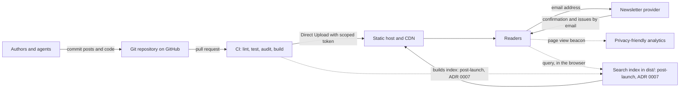

# Architecture

Status: proposed. Venkat approves this document and ADRs 0004 to 0008 as one batch with M1, because they are M1 exit items. This document describes the system, its data flows, the content model, the environments and the integration points. The choices behind it are in ADR 0001 (stack) and ADRs 0004 to 0008 (hosting, newsletter, analytics, search, cost). Names of services below are options only. No account for any of them exists yet.

## Architecture diagram

Reading the diagram:

- The site is static output (ADR 0001). There is no application server and no database.
- The host serves files from the CDN. Readers talk to the newsletter provider and the analytics provider directly, not through our code.
- Search runs in the reader's browser against an index built in CI.

## Data flows

| Flow | Steps | Personal data |
|---|---|---|
| Publish | Author or agent opens a feature branch, commits a post with `draft: true`. A PR runs CI. The editor and SEO reviewers approve. Venkat approves setting `draft: false`. Merge to `develop` deploys staging. A release from `main` deploys production, through a protected GitHub environment that Venkat approves. Every deploy is a Direct Upload from a GitHub Actions job (see Environments). | None. Git history holds author names and commit emails already public on GitHub. |
| Subscribe | Reader enters an email on the site form. The browser posts it to the newsletter provider. The provider sends a confirmation email. The address becomes active only after the reader clicks the link (double opt-in). | Email address goes to the newsletter provider only. Our site code never stores it. |
| Analytics | A small script, or the host's edge, records a page view. Reports are read in the provider dashboard. | Aim for none stored on the reader's device. IP address is processed by the provider. See ADR 0006 for the PECR and UK GDPR position. |
| Search | None at launch (ADR 0007). After about 10 posts, CI builds a static index after `astro build`. The reader's browser loads the index files and searches locally. | None leaves the browser. |
| Draft | Drafts exist only in git, in local dev and in access-controlled PR previews built with `PREVIEW_DRAFTS=true`. Staging and production builds exclude them (`src/config.ts`). | None. |

Where personal data goes: only to the newsletter provider (email address) and to the analytics provider and host (IP address in server logs). Each provider needs a data processing agreement and a privacy notice entry. Venkat is the controller.

## Content model

Posts are Markdown or MDX files in `content/posts/`. The Astro content collection validates the front-matter with `src/lib/postSchema.ts`. An invalid post fails the build.

### Entities

| Entity | What it is | Where it lives today |
|---|---|---|
| Post | One article, one file. The slug is the file name. | `content/posts/<slug>.md` or `.mdx` |
| Author | The named byline. Phase 1 has one site byline, so there is no author data yet. | Proposal below |
| Tag | A label from the approved list in `docs/prd/content-pillars.md`, not free text. 3 to 5 per post: the pillar tag first, one format tag, then up to 3 topic tags. Roundups have no pillar tag, so they have 3 or 4. | The `tags` array in each post. No separate file. |
| Series | An ordered group of posts on one theme. | Proposal below |

### Front-matter schema (current, matches `src/lib/postSchema.ts`)

| Field | Type | Rule |
|---|---|---|
| `title` | string | Required. 1 to 70 characters. |
| `description` | string | Required. 1 to 160 characters. |
| `date` | date | Required. Coerced from a string such as `2026-12-14`. |
| `updated` | date | Optional. Set when a post is materially changed. |
| `tags` | array of strings | Optional. Defaults to an empty array. |
| `draft` | boolean | Optional in the schema, defaults to `false`. Project rule: new posts start as `draft: true`. |

Gap: the schema default for `draft` is `false` in `src/lib/postSchema.ts`, but the project rule in `CLAUDE.md` and threat-model risk R10 assume every new post starts as `draft: true`. A post that forgets the field would be published. I have not changed code. Requirement for the Frontend Engineer: either make `npm run check:content` fail on any post with no explicit `draft` field, or change the schema default to `true`. Either way needs a failing test first. Venkat decides which.

### Proposals (not in the schema yet)

These need Venkat's approval and a schema change with a test first. Each is optional so existing posts stay valid.

| Field | Type | Why |
|---|---|---|
| `series` | string slug (flat, no nesting) | Group posts in one series. |
| `seriesOrder` | number, optional, used with `series` | Order inside a series, for previous and next links. |
| `author` | string, key into a small `authors` data file | Byline and JSON-LD author. Defaults to the site name. Needed only if guest authors arrive (out of scope in Phase 1). |
| `canonical` | URL string, validated as `https` only | Set when a post first appeared elsewhere. SEO then uses it instead of the page URL. The schema must reject `http`, `javascript:` and other schemes. |

Tags rule (proposal): 3 to 5 tags per post. The first is one pillar tag, then one format tag, then up to 3 topic tags. Tags are lower case and hyphenated. One tag page per tag is generated at build time.

Structured data: each post page emits JSON-LD of type `BlogPosting`, built from `title`, `description`, `date`, `updated` and the author byline.

## Environments

| Environment | Purpose | URL | Indexing | Drafts | Secrets |
|---|---|---|---|---|---|
| local | Development on a laptop with `make dev` | `http://localhost:4321` | noindex | Shown in dev | A gitignored `.env` with placeholders only |
| preview | One build per same-repo pull request, to review a change. Fork PRs get no token and no preview. | A per-PR URL from the host (name depends on ADR 0004) | noindex | Shown only with `PREVIEW_DRAFTS=true`, and only if the preview is behind access control. Without access control, previews exclude drafts (threat-model R10). | A preview and staging deploy token with no production rights, held as a GitHub environment secret for the deploy job only. No other secrets. |
| staging | Built from `develop`. Feature-complete check at gate M3. | A staging address on the host. A custom staging domain may not be possible, see ADR 0004. | noindex unless `ALLOW_INDEXING=true`, which staging never sets | Excluded (`src/config.ts`) | The preview and staging deploy token (GitHub environment secret) and build-time variables for a test newsletter list and a test analytics site, if used. Variables live in a GitHub environment. |
| production | The live blog, built from `main` | The custom domain, launch 14 Dec 2026 | Indexed. Only production sets `ALLOW_INDEXING=true`. | Excluded (`src/config.ts`) | A separate production deploy token and build-time variables, in a protected GitHub environment that Venkat approves. Venkat holds the host logins. |

How deploys work:

- Deploys use Direct Upload from a GitHub Actions job. The host's own Git integration is off.
- There are two tokens. Staging deploys from `develop` and PR previews use one scoped token with no production rights. Production uses a separate token.
- Both tokens are scoped to deploy only. Their owner is Venkat. They are rotated every 90 days.
- Fork PRs get no token and no preview.
- Production deploys only from `main`, through a protected environment that needs Venkat's approval (`docs/threat-model.md`).
- Build-time variables belong in GitHub environments, not in a host secret store. The site has no server, so the host holds no runtime secrets.

What differs between environments:

- `allowIndexing` in `src/config.ts` reads `ALLOW_INDEXING`. It drives the robots meta tag and `robots.txt`. CI checks that the default build has `noindex` and `Disallow: /`.
- `includeDrafts` is true in dev or when `PREVIEW_DRAFTS=true`.
- Analytics and newsletter use separate test and live configuration, so staging never adds real data.
- Secrets follow `docs/guidelines/secrets-and-access.md`: none in git, CI and build-time secrets in GitHub environments, rotation every 90 days.
- Uptime, rollback and recovery are in ADR 0004. Git is the source of truth for the site.

## Integration points

All three are called from the reader's browser or from CI. None is called from a server of ours, because there is none.

### Newsletter

| Item | Contract |
|---|---|
| Who calls whom | Browser posts to the provider's public subscribe endpoint. The endpoint needs no secret. The form carries no API key, because the site has no server and any key in the page would be public. Provider calls the reader's mailbox. |
| If a key is ever needed | Use a first-party handler that holds the key. That handler must first be added to the threat model and the CSP (`connect-src`), and Venkat must approve it. Not planned for Phase 1. |
| CSP | Add the provider's form origin to `form-action`. Venkat approves the change. Test on staging in report-only mode first. |
| Data | Email address. Optional: a source tag such as the post slug. |
| Double opt-in | Required. A subscriber is counted for G3 only after confirming. |
| Failure behaviour | The form shows a plain error and keeps the typed address. The site stays up. A link to the provider's hosted page is the fallback. A progressive enhancement form posts without JavaScript. |
| Privacy | Consent text next to the form, link to the privacy notice, unsubscribe link in every issue. |

### Analytics

| Item | Contract |
|---|---|
| Who calls whom | Browser sends a page view to the provider. We never call it from CI or code. |
| Data | Page path, referrer, country, device class. No personal identifiers stored by us. |
| Failure behaviour | If the script is blocked or down, nothing breaks. The script loads async and deferred so it does not hurt LCP or INP. |
| Conversion counts | The recommended tool (Cloudflare Web Analytics) has no custom events. Conversion and subscriber counts come from the newsletter provider's report plus page views. If events are needed, Plausible is the upgrade (ADR 0006). |
| CSP | The chosen tool's beacon origin would be added to `script-src` and `connect-src`. Today `docs/threat-model.md` has `script-src 'self'` and `connect-src 'self'`, so this is a proposal that needs a threat-model update and Venkat's approval. SRI cannot pin a vendor beacon that changes, so prefer self-hosting or a different tool. If the host injects the beacon at the edge, it must still pass the CSP and must not bypass it. |
| Privacy | Not legal advice. Prefer a cookieless tool so no consent banner is needed. PECR covers accessing information on a device as well as setting cookies, so a cookieless tool still needs the check. Full position in ADR 0006. |

### Search

| Item | Contract |
|---|---|
| Who calls whom | None at launch (ADR 0007). After about 10 posts, CI runs the index builder after `astro build`, and the browser loads index files from the same host. |
| Data | Public post text only. No query leaves the browser. |
| Failure behaviour | If the index fails to load, the search box says so and links to the tag pages and the archive. |
| Privacy | None. No third party. |
